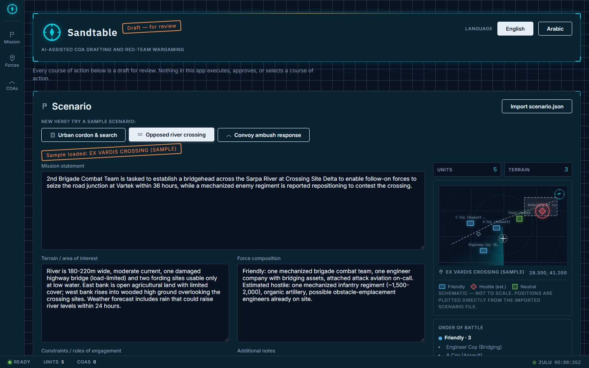
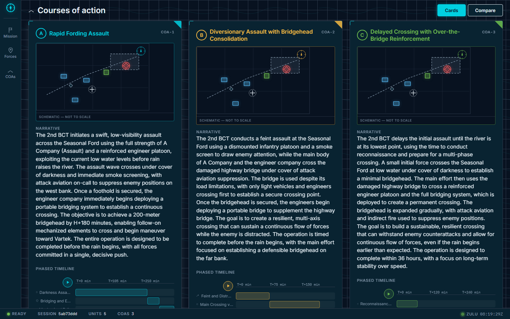
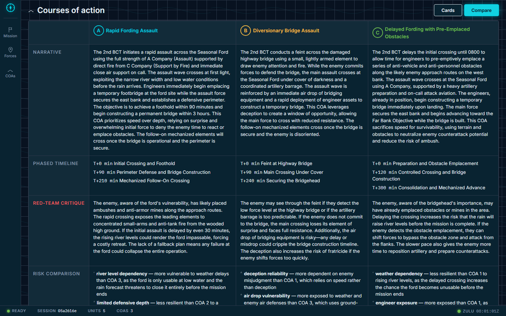
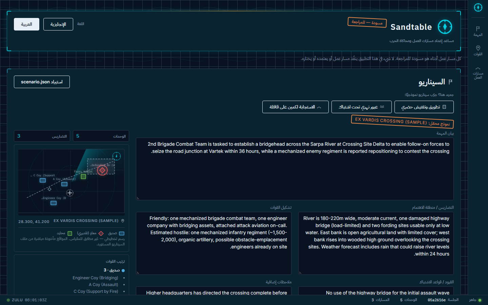
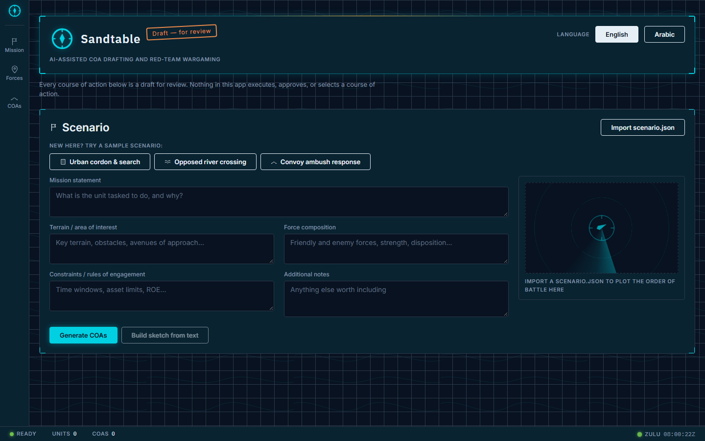
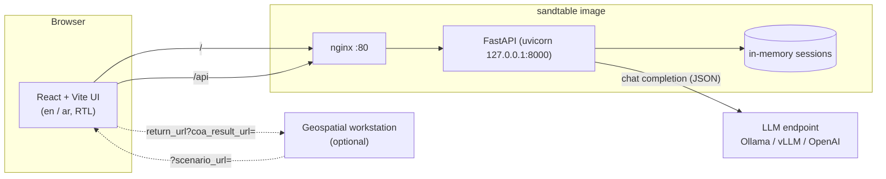
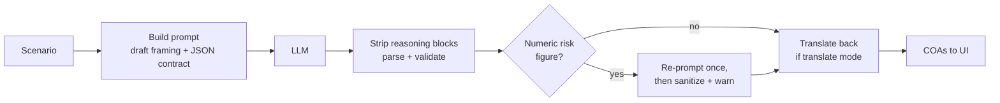

<p align="center">
  
</p>

<h1 align="center">Sandtable</h1>

<p align="center">
  AI-assisted course-of-action drafting and red-team wargaming for staff planners.<br />
  Self-hosted, works offline, and talks to the LLM you run.
</p>

<p align="center">
  <a href="https://github.com/soimthe1/sandtable/actions/workflows/ci.yml"></a>
  <a href="LICENSE"></a>
  
  
  
</p>



A planner describes a scenario: mission, terrain, forces, constraints. Sandtable asks an LLM to
draft two or three **distinct** courses of action (COAs). Each draft has a phased timeline, a
deliberately adversarial **red-team critique**, and a **qualitative, comparative** risk
assessment. The planner revises individual COAs, compares them side by side, and exports the one
they accept.

> **Drafts, never decisions.** Sandtable has no connection to any live system, sensor or execution
> path. Every COA is a draft for human review. The app never scores, ranks, recommends or selects a
> course of action, and it blocks the model from inventing confidence numbers (see
> [Design principles](#design-principles)).

## Contents

- [Features](#features)
- [Applied AI techniques](#applied-ai-techniques)
- [Screenshots](#screenshots)
- [Quick start](#quick-start)
- [Configuration](#configuration)
- [Branding](#branding)
- [Architecture](#architecture)
- [API](#api)
- [Workstation handoff](#workstation-handoff)
- [Deployment](#deployment)
- [Design principles](#design-principles)
- [Development](#development)
- [Limitations](#limitations)
- [License](#license)

## Features

- **COA drafting.** Two or three distinct candidate COAs per scenario, each with narrative, a phased
  timeline and a red-team critique. Revise any COA with free-text guidance.
- **Qualitative risk only.** Each risk is stated relative to the other COAs ("more exposed than
  COA 2 on the northern flank, because..."). A guardrail scans every risk text for percentages and
  scores, re-prompts once if it finds a figure, then strips the figure and warns.
- **Three ways in.** Fill in the form, upload a `scenario.json`, or have a geospatial workstation
  hand a scenario over by URL.
- **Schematic sand table.** A "not to scale" plot and an order-of-battle roster drawn from the
  scenario's own coordinates. No basemap and no tiles.
- **Sketch from text.** For a typed-only scenario, draws a relative layout of the units the text
  names, in a 0..1 frame that you can edit. It never invents latitude or longitude, and it is never
  exported.
- **Compare view.** All COAs side by side: narrative, phases, red team, risk. No score column.
- **Phase timeline** with step-through playback, for reading a plan the model already wrote.
- **Export** of the accepted COA as `coa_result.json` with an embedded CZML mission bundle.
- **English and Arabic** UI with full right-to-left layout, plus an optional
  translate-through-English mode for Arabic input.
- **Bring your own model.** Ollama (native API, guaranteed-JSON mode), vLLM or OpenAI. Switching
  is a config edit.
- **Air-gap friendly.** One Docker image, fonts bundled, no CDN. The only outbound connection is to
  your LLM endpoint.
- **Brandable.** Name, logo, colours and favicon come from an optional, git-ignored folder.

## Applied AI techniques

What this project demonstrates, beyond "call an LLM":

| Technique | Where |
|---|---|
| **Structured generation**: a strict JSON contract, constrained decoding (Ollama `format: json`, OpenAI `response_format`), Pydantic validation of every response | `prompts/system_prompts.py`, `schemas/`, `services/ai_providers.py` |
| **Output guardrails**: regex detection of fabricated confidence figures, a targeted repair re-prompt, then deterministic sanitization with a visible warning | `services/guardrails.py`, `services/coa_generator.py` |
| **Prompt engineering for adversarial critique**: a red-team role that must attack each plan, plus draft framing that forbids recommendation language | `prompts/system_prompts.py` |
| **Reasoning-model handling**: per-endpoint "don't think" switches, and `<think>` blocks always stripped before parsing | `services/ai_providers.py` |
| **Grounded extraction instead of invention**: relations read from free text into a bounded 0..1 frame, with out-of-range output dropped rather than rescaled | `services/sketch_extractor.py` |
| **Multilingual LLM pipeline**: native Arabic generation, or a translate-reason-translate-back mode | `services/translation.py` |
| **Provider-agnostic LLM layer**: Ollama, vLLM and OpenAI behind one interface, with named profiles chosen by config | `services/llm_client.py`, `config/` |
| **Responsible-AI UX**: no scores, rankings or "recommended" labels, a standing draft stamp, and every visual drawn deterministically from returned data | `frontend/src/components/` |
| **Offline / self-hosted deployment**: a single container, bundled assets, and no outbound calls except to the model | `docker/`, `docs/DEPLOYMENT.md` |

**Stack:** Python 3.12 · FastAPI · Pydantic v2 · httpx · React 18 · TypeScript · Vite · i18next
(RTL) · SVG/CSS visualization · Docker · nginx · supervisord · GitHub Actions · Ollama / vLLM /
OpenAI-compatible APIs.

## Screenshots

| Generated COAs | Side-by-side comparison |
|---|---|
|  |  |

| Arabic, right to left | Empty start screen |
|---|---|
|  |  |

All scenarios shown are the built-in fictional samples. Place and unit names are invented.

## Quick start

### Prerequisites

- An LLM endpoint. The easiest is [Ollama](https://ollama.com) on the same machine:
  `ollama pull qwen3:30b-a3b-instruct-2507-q8_0` (or any instruction-tuned model; smaller models
  work but follow the JSON contract less reliably).
- For Docker: Docker with Compose.
- For local development: Python 3.11+, Node.js 20+.

### Option A: Docker (production image)

```bash
git clone https://github.com/soimthe1/sandtable.git && cd sandtable
cp config/config.example.yaml config/config.yaml
cp config/config.prod.example.yaml config/config.prod.yaml
cp .env.prod.example .env.prod
# edit config/config.prod.yaml: ai.default.base_url and model
#   (Ollama on the Docker host: http://host.docker.internal:11434)
docker build -f docker/Dockerfile -t sandtable:1.0.0 .
docker compose -f docker-compose.prod.yaml --env-file .env.prod up -d
```

Open http://localhost:8080 and click a sample scenario, then **Generate COAs**.

### Option B: local development

**Windows (PowerShell):**

```powershell
.\scripts\dev.ps1 setup   # venv, npm packages, .env and config/*.yaml from templates
.\scripts\dev.ps1 start   # API on :8000, UI on :5173, opens the browser
```

**Linux / macOS:**

```bash
cp .env.example .env
cp config/config.example.yaml config/config.yaml
cp config/config.prod.example.yaml config/config.prod.yaml

cd backend
python3 -m venv .venv && . .venv/bin/activate
pip install -r requirements.txt
uvicorn app.main:app --reload --port 8000 &

cd ../frontend
npm ci
npm run dev          # http://localhost:5173, proxies /api to :8000
```

Check the LLM connection at any time: `curl http://localhost:8000/api/health/llm`.

### Option C: Docker dev stack (hot reload)

```bash
docker compose up -d        # UI http://localhost:9010, API http://localhost:8000
docker compose logs -f frontend
```

## Configuration

| File | Tracked | Holds |
|---|---|---|
| `config/config.example.yaml` | yes | Template for `config.yaml` |
| `config/config.prod.example.yaml` | yes | Template for `config.prod.yaml` |
| `config/config.yaml` | **no** | Every non-secret setting: AI profiles under `ai:`, app settings under `app:` |
| `config/config.prod.yaml` | **no** | The same keys with production values; merged over `config.yaml` when `APP_ENV=prod` |
| `.env` / `.env.prod` | **no** | Secrets only: `LLM_API_KEY` |

The loader (`backend/app/config.py`) rejects unknown keys, and rejects any secret-looking key in
YAML, at startup.

```yaml
ai:
  default:
    provider: ollama                  # ollama | openai (OpenAI, vLLM) | comfyui
    base_url: http://localhost:11434  # openai/vLLM: ends in /v1
    model: qwen3:30b-a3b-instruct-2507-q8_0
    suppress_thinking: true           # ask reasoning models not to think
    timeout_seconds: 180
    # api_key_env: LLM_API_KEY        # for endpoints that need a key
```

| `app:` key | Purpose |
|---|---|
| `display_name` | Product name in the API title (`/docs`) |
| `default_ui_language` | `en` or `ar` |
| `translation_mode` | `native` (model answers in the UI language) or `translate` (round-trip through English) |
| `json_mode` | Request guaranteed-JSON output; set `false` if the endpoint rejects it |
| `risk_guardrail_max_retries` | Re-prompts allowed when a numeric risk figure is detected |
| `cors_origins` | Allowed browser origins (development; empty in production behind nginx) |
| `scenario_url_allowed_hosts` | Hostname allowlist for URL import; empty allows any host (development only) |
| `scenario_url_fetch_timeout_seconds` | Timeout for server-side scenario fetches |

Frontend build-time settings: `VITE_DEFAULT_UI_LANGUAGE` (`en`) and `VITE_API_BASE_URL` (empty, same
origin), passed as Docker build arguments. Never give a secret a `VITE_` prefix: those values are
compiled into public JavaScript.

## Branding

The repository ships a neutral identity: the name *Sandtable*, a compass-rose symbol and a dark
teal palette. To run it under your own name, copy `frontend/brand.example/` to
`frontend/brand.local/` and edit it:

```
frontend/brand.local/          # git-ignored, every file optional
  brand.json                   # tab title + any UI strings per language (name, tagline, ...)
  brand.css                    # --brand-* colour tokens
  symbol.svg | symbol.png      # header and nav-rail logo
  favicon.png | .svg | .ico    # tab icon (defaults to the symbol)
```

The dev server, `npm run build` and the Docker image pick the folder up automatically. A clone
without it builds with the defaults. Details: [`frontend/brand.example/README.md`](frontend/brand.example/README.md).

## Architecture



One generation request runs this pipeline:



| Path | Purpose |
|---|---|
| `backend/app/routers/` | HTTP layer only: `health`, `scenario`, `coa`, `export` |
| `backend/app/services/llm_client.py` | The only module that talks to an LLM |
| `backend/app/services/coa_generator.py` | Prompt, call, guardrail, translate, validate |
| `backend/app/services/guardrails.py` | Detects and strips fabricated confidence figures |
| `backend/app/services/sketch_extractor.py` | Relative layout from free text (reads, never invents) |
| `backend/app/prompts/system_prompts.py` | Every prompt and the JSON contract |
| `backend/app/schemas/` | Pydantic models: the wire and file contracts |
| `frontend/src/components/` | Sand table, roster, COA cards, timeline, compare view |
| `frontend/src/brand/` | Default brand and the `brand.local` loader |
| `frontend/src/i18n/` | English and Arabic strings |
| `docker/` | Single production image (nginx + uvicorn under supervisord) |

More detail: [docs/ARCHITECTURE.md](docs/ARCHITECTURE.md).

## API

Interactive docs at `/docs` on a running backend.

| Method | Path | Purpose |
|---|---|---|
| GET | `/api/health` | Configuration status (no network call) |
| GET | `/api/health/llm` | Live check of the LLM endpoint and model |
| POST | `/api/scenario/import` | Import a `scenario.json` file |
| POST | `/api/scenario/import-url` | Fetch and validate a `scenario.json` from a URL (server-side) |
| POST | `/api/scenario/sketch` | Relative layout sketch from free text |
| POST | `/api/coa/generate` | Generate COAs |
| POST | `/api/coa/revise` | Revise one COA |
| GET | `/api/coa/session/{session_id}` | A session's results |
| POST | `/api/export/coa` | Download an accepted COA as `coa_result.json` |
| GET | `/api/export/coa/{session_id}/{coa_id}` | Fetch an accepted COA by URL |

## Workstation handoff

A mission-planning workstation can open Sandtable with a scenario and get the accepted COA back,
with no shared code, database or iframe:

```
https://<sandtable-host>/?scenario_url=<url-to-scenario.json>&return_url=<url-to-return-to>
```

- `scenario_url`: the backend fetches it server-side (so no browser CORS setup is needed) and
  validates it against the same contract as a file upload.
- `return_url`: after export, a **Return to workstation** button goes to
  `return_url?coa_result_url=<url>`, and the workstation does a plain GET on that URL.

URL import is a server-side fetch of a caller-supplied URL. Set `scenario_url_allowed_hosts` in any
exposed deployment. The export URL is not authenticated and only resolves while the in-memory
session exists.

## Deployment

Production is one image (nginx serving the UI and proxying `/api` to uvicorn in the same
container), shipped as a `.tar` so the target needs no internet:

```powershell
.\scripts\dev.ps1 build                      # Windows -> dist\sandtable-<timestamp>.tar
.\scripts\dev.ps1 build -DefaultLanguage ar  # Arabic as the default UI language
```

```bash
# on the target
docker load -i sandtable-<timestamp>.tar
docker compose -f docker-compose.prod.yaml --env-file .env.prod up -d   # http://<host>:8080
```

Step-by-step guide covering Linux/macOS builds, configuration, verification and troubleshooting:
**[docs/DEPLOYMENT.md](docs/DEPLOYMENT.md)**. TLS is not included; put a reverse proxy in front for
HTTPS.

## Design principles

These are product requirements, not style choices:

1. **No fabricated confidence.** Risk is qualitative and comparative, never a percentage, decimal or
   X/10 score. Enforced three times: in the system prompt, by a regex scan, and by a repair
   re-prompt with a sanitizing fallback.
2. **Draft framing.** Prompts and UI copy never say a COA is "correct", "recommended" or
   "to be executed". There is a standing DRAFT stamp and disclaimer, and no score, ranking or
   recommendation anywhere.
3. **Surveyed vs. read-from-prose positions never merge.** Imported coordinates are plotted and
   exported. Text-derived sketches are relative, labelled as such, editable, and excluded from
   export.
4. **Deterministic visuals.** Everything drawn is rendered from data the backend returned. Nothing
   is generated imagery, and there is no fake basemap or simulation chart.
5. **One provider seam.** Only `llm_client.py` knows which LLM provider is in use.

## Development

```powershell
.\scripts\dev.ps1 test     # backend compile + import check, frontend type check + build
```

On Linux/macOS: `python -m compileall backend/app`, then `npm run build` in `frontend/`. CI runs the
same checks on every push ([.github/workflows/ci.yml](.github/workflows/ci.yml)).

Contributions are welcome: see [CONTRIBUTING.md](CONTRIBUTING.md).

## Limitations

- No automated test suite yet. Guardrails, provider request shapes and the URL routes are the first
  candidates.
- Sessions live in process memory: a restart clears them. No authentication; intended for
  single-planner use on a trusted network.
- The CZML export carries the imported geometry forward. It does not invent maneuver graphics the
  model never planned on a map.
- Switching UI language does not retranslate COAs that were already generated.

## License

[MIT](LICENSE)
